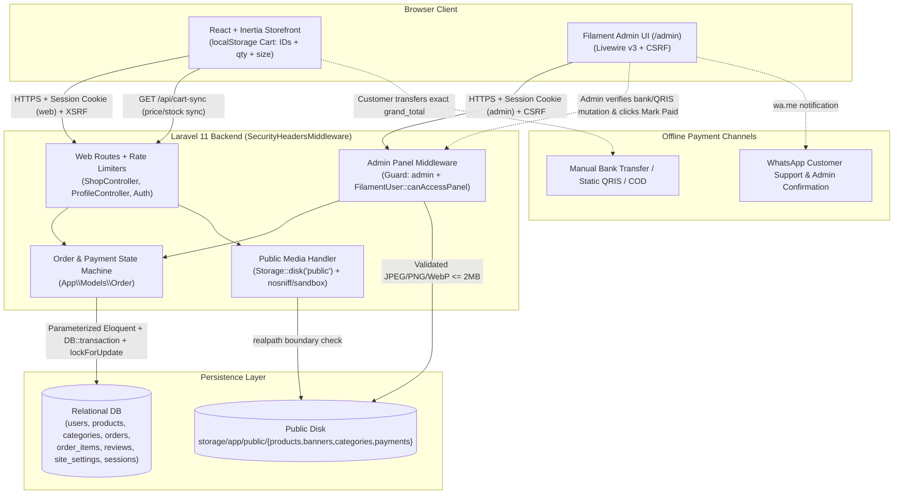

# Security Audit & Hardening Report — Batik Daffa E-Commerce

- **Project:** Batik Daffa E-Commerce (`laravel-app`)
- **Audit Date:** 2026-11-27
- **Standards Referenced:** OWASP ASVS 5.0.0, OWASP Web Security Testing Guide (WSTG), OWASP API Security Top 10 (2023), PCI DSS v4.0.1 (Merchant Applicability Assessment)
- **Verification Basis Legend:**
  - ✅ **Confirmed:** Verified directly via source code inspection and/or automated test execution.
  - ⚠️ **Inference:** Logical architectural conclusion derived from inspected files where runtime production hosting is not yet provisioned.
  - 🚫 **Blocked / Untested in Local Environment:** Could not be executed locally due to missing host binary or offline sandbox network isolation; documented transparently below.

---

## 1. Executive Summary

A comprehensive, full-stack application security audit and business-logic review was conducted on the **Batik Daffa E-Commerce** application located in [laravel-app](file:///c:/Users/khama/PROYEK WEBSITE PENGMAS/laravel-app). The engagement covered frontend React/Inertia views, Laravel 11 controllers and models, Filament v3 administrative resources, authentication and session guards, payment and order workflows, file storage routes, environment configuration, and locked dependencies.

### Pre-Audit Posture vs. Post-Hardening Posture

Prior to remediation, the application already implemented several sound foundational practices—most notably server-side price recalculation and row-level pessimistic locking (`lockForUpdate()`) during checkout, separate `web` and `admin` session guards, and Eloquent query parameterization. However, **critical and high-severity vulnerabilities** existed in credential provisioning, object-level authorization (IDOR/BOLA), guest/customer authentication checks, payment/order state management, and endpoint rate limiting:

1. **CRITICAL (`BD-SEC-001`):** Hardcoded plaintext administrator credentials were committed in [DatabaseSeeder.php](file:///c:/Users/khama/PROYEK WEBSITE PENGMAS/laravel-app/database/seeders/DatabaseSeeder.php) and automatically executed during `php artisan migrate` in all non-test environments (including production) via [2026_11_27_000002_seed_initial_store_data.php](file:///c:/Users/khama/PROYEK WEBSITE PENGMAS/laravel-app/database/migrations/2026_11_27_000002_seed_initial_store_data.php). Compromise of `/admin` directly allows replacement of the store's bank account number and QRIS image in [ManagePaymentSettings.php](file:///c:/Users/khama/PROYEK WEBSITE PENGMAS/laravel-app/app/Filament/Pages/ManagePaymentSettings.php), enabling silent diversion of customer payments.
2. **HIGH (`BD-SEC-002`):** Unauthenticated Insecure Direct Object Reference (IDOR / OWASP API1:2023) on `GET /pesanan/{orderCode}` and `GET /pesanan?code=...` exposed full customer Personally Identifiable Information (PII)—including recipient name, phone number, and home shipping address—for both registered-user and guest orders without ownership verification.
3. **HIGH (`BD-SEC-003`):** Broken authentication logic in `POST /pesanan/{orderCode}/selesai` and `POST /pesanan/{orderCode}/ulasan` (`if ($order->user_id && auth('web')->check() && ...)`) evaluated to `false` whenever the requester was logged out, allowing unauthenticated attackers to mark any user's shipped/processed order as completed and forge product reviews.
4. **HIGH (`BD-SEC-004`):** Absence of a server-side payment state machine and cancellation stock restoration allowed invalid order/payment transitions and permanent inventory loss whenever orders were cancelled (`batal`).
5. **HIGH (`BD-SEC-005`):** Absence of rate limiting (`throttle`) on guest checkout (`POST /checkout`), order lookup, and sensitive authentication routes allowed automated inventory exhaustion (Denial of Inventory) and brute-force enumeration.

All **12 code-level findings** (`1 Critical`, `4 High`, `5 Medium`, `2 Low`) have been remediated directly in the codebase and verified via **46 automated PHPUnit feature/security/regression tests (240 assertions)**, **Vite production bundle compilation**, **bundle secret scanning**, and **Laravel Pint static formatting checks**.

### Summary of Findings

| ID | Vulnerability Title | Severity | CVSS v3.1 | Status |
|---|---|---|---|---|
| `BD-SEC-001` | Hardcoded Admin Credentials Auto-Seeded During Production Migrations | **CRITICAL** | 9.8 | **FIXED** |
| `BD-SEC-002` | Unauthenticated IDOR & Full Customer PII Exposure on Order Endpoints | **HIGH** | 7.5 | **FIXED** |
| `BD-SEC-003` | Authentication Logic Bypass on Order Completion & Review Submission | **HIGH** | 7.5 | **FIXED** |
| `BD-SEC-004` | Missing Payment State Machine & Unrestored Inventory on Order Cancellation | **HIGH** | 7.5 | **FIXED** |
| `BD-SEC-005` | Missing Rate Limiting on Checkout, Order Lookup, and Auth Routes (Inventory DoS) | **HIGH** | 7.5 | **FIXED** |
| `BD-SEC-006` | Mass Assignment Privilege Escalation Vector on `User::$fillable` (`is_admin`) | **MEDIUM** | 6.5 | **FIXED** |
| `BD-SEC-007` | Account Enumeration on Password Reset & Missing Multi-Session Invalidation | **MEDIUM** | 5.3 | **FIXED** |
| `BD-SEC-008` | Checkout Quantity-Cap Split Bypass, Phone Sanitization Bypass & Replay Risk | **MEDIUM** | 5.3 | **FIXED** |
| `BD-SEC-009` | Missing HTTP Security Headers, Session Encryption, and `/storage` MIME Sandboxing | **MEDIUM** | 5.4 | **FIXED** |
| `BD-SEC-010` | Unvalidated CTA URL Schemes (`javascript:` / Open Redirect) & Negative Shipping Fee | **MEDIUM** | 5.4 | **FIXED** |
| `BD-SEC-011` | Composer Security Advisory Blocking Disabled (`advisories.block = false`) | **LOW** | — | **FIXED** |
| `BD-SEC-012` | Admin Route Disclosure via Unfiltered Ziggy `@routes` & SQL `LIKE` Wildcard Handling | **LOW** | — | **FIXED** |

---

## 2. Technology and Architecture

### Verified Stack Inventory

- ✅ **Backend Runtime & Framework:** PHP `8.3.36`, Laravel Framework `v11.57.1` ([composer.json](file:///c:/Users/khama/PROYEK WEBSITE PENGMAS/laravel-app/composer.json#L8-L16))
- ✅ **Frontend Stack:** React `18.3.1`, Inertia.js (`@inertiajs/react` `2.3.29`, `inertiajs/inertia-laravel` `v2.0.28`), Vite `6.4.6`, Tailwind CSS `3.4.19` ([package.json](file:///c:/Users/khama/PROYEK WEBSITE PENGMAS/laravel-app/package.json#L8-L22))
- ✅ **Admin Panel:** Filament `v3.3.57` on Livewire `v3.8.11` mounted at `/admin` ([AdminPanelProvider.php](file:///c:/Users/khama/PROYEK WEBSITE PENGMAS/laravel-app/app/Providers/Filament/AdminPanelProvider.php#L30-L86))
- ✅ **Database & ORM:** Eloquent ORM; SQLite (`database/database.sqlite`) configured for local development and `:memory:` for PHPUnit; MySQL/MariaDB targeted for production deployment ([config/database.php](file:///c:/Users/khama/PROYEK WEBSITE PENGMAS/laravel-app/config/database.php#L19-L83))
- ✅ **Authentication & Guards:** Session-based authentication with two isolated guards in [config/auth.php](file:///c:/Users/khama/PROYEK WEBSITE PENGMAS/laravel-app/config/auth.php#L38-L48): `web` (storefront customers, Laravel Breeze controllers) and `admin` (Filament panel, gated by `User::canAccessPanel()` checking `(bool) $this->is_admin`). `laravel/sanctum` `v4.4.0` is installed in `vendor/` but no API token issuance routes are active.
- ✅ **Payment Integration Detected:** **Manual Offline Payment Verification** (Bank Transfer account details, Static Merchant QRIS image upload, and Cash on Delivery / COD) managed via `site_settings` in [ManagePaymentSettings.php](file:///c:/Users/khama/PROYEK WEBSITE PENGMAS/laravel-app/app/Filament/Pages/ManagePaymentSettings.php#L35-L180). **No third-party automated payment gateway SDK, API key, or webhook callback (e.g., Midtrans, Xendit, Stripe, Doku) is implemented.**
- ✅ **Environment Variables Configured (Keys Only, Values Redacted):** `APP_NAME`, `APP_ENV`, `APP_KEY`, `APP_DEBUG`, `APP_TIMEZONE`, `APP_URL`, `APP_LOCALE`, `APP_FALLBACK_LOCALE`, `APP_FAKER_LOCALE`, `APP_MAINTENANCE_DRIVER`, `PHP_CLI_SERVER_WORKERS`, `BCRYPT_ROUNDS`, `LOG_CHANNEL`, `LOG_STACK`, `LOG_DEPRECATIONS_CHANNEL`, `LOG_LEVEL`, `DB_CONNECTION`, `SESSION_DRIVER`, `SESSION_LIFETIME`, `SESSION_ENCRYPT`, `SESSION_SECURE_COOKIE`, `SESSION_PATH`, `SESSION_DOMAIN`, `BROADCAST_CONNECTION`, `FILESYSTEM_DISK`, `QUEUE_CONNECTION`, `CACHE_STORE`, `CACHE_PREFIX`, `MEMCACHED_HOST`, `REDIS_CLIENT`, `REDIS_HOST`, `REDIS_PASSWORD`, `REDIS_PORT`, `MAIL_MAILER`, `MAIL_SCHEME`, `MAIL_HOST`, `MAIL_PORT`, `MAIL_USERNAME`, `MAIL_PASSWORD`, `MAIL_FROM_ADDRESS`, `MAIL_FROM_NAME`, `AWS_ACCESS_KEY_ID`, `AWS_SECRET_ACCESS_KEY`, `AWS_DEFAULT_REGION`, `AWS_BUCKET`, `AWS_USE_PATH_STYLE_ENDPOINT`, `VITE_APP_NAME`, plus optional `SEED_ADMIN_EMAIL`, `SEED_ADMIN_NAME`, `SEED_ADMIN_PASSWORD` ([.env.example](file:///c:/Users/khama/PROYEK WEBSITE PENGMAS/laravel-app/.env.example#L1-L72)).

### Architecture & Security Data Flow



---

## 3. Security Findings

### `BD-SEC-001` — Hardcoded Administrator Credentials Auto-Seeded in Production Migrations

- **Severity:** **CRITICAL** (`CVSS:3.1/AV:N/AC:L/PR:N/UI:N/S:U/C:H/I:H/A:H` — **9.8**)
- **Affected Component:** Database Seeding & Production Migration Pipeline
- **Files:**
  - [DatabaseSeeder.php](file:///c:/Users/khama/PROYEK WEBSITE PENGMAS/laravel-app/database/seeders/DatabaseSeeder.php#L15-L30)
  - [2026_11_27_000002_seed_initial_store_data.php](file:///c:/Users/khama/PROYEK WEBSITE PENGMAS/laravel-app/database/migrations/2026_11_27_000002_seed_initial_store_data.php#L12-L26)
- **Root Cause:** `DatabaseSeeder::run()` contained a hardcoded administrator email and plaintext password (`[REDACTED]`) with `'is_admin' => true`. Furthermore, migration `2026_11_27_000002_seed_initial_store_data.php` invoked `(new DatabaseSeeder())->run()` automatically during `php artisan migrate` whenever `User::where('is_admin', true)->doesntExist()` in all environments except PHPUnit (`runningUnitTests()`).
- **Technical Explanation:** In Laravel deployments, `php artisan migrate --force` is standardly executed in production. Coupling schema migrations with hardcoded credential seeding guaranteed that any fresh production database would automatically provision a known super-admin account accessible at `/admin/login`.
- **Potential Business Impact:** Full administrative takeover. An attacker logging into `/admin` can modify `pay_bank_account` and upload a fraudulent QRIS code in [ManagePaymentSettings.php](file:///c:/Users/khama/PROYEK WEBSITE PENGMAS/laravel-app/app/Filament/Pages/ManagePaymentSettings.php#L156-L172), silently redirecting 100% of customer payments to an attacker-controlled bank/e-wallet account while accessing all customer PII in `orders`.
- **Evidence & Reproducibility:** Confirmed by direct inspection of `DatabaseSeeder.php` (hardcoded `User::firstOrCreate` with `is_admin => true`) and `2026_11_27_000002_seed_initial_store_data.php`. Credentials have been redacted per security policy.
- **Recommended Remediation:** Remove all hardcoded credentials from source code; decouple admin user creation from migrations; require explicit `php artisan make:filament-user` or strong environment-injected variables (`SEED_ADMIN_EMAIL` and `SEED_ADMIN_PASSWORD` >= 12 chars) during explicit seeding. Also rotate/delete any previously seeded admin account in existing local/staging databases.
- **Fix Status:** **FIXED IN CODEBASE** (Operational rotation required if any existing `.sqlite`/MySQL DB already ran the old seeder).
- **Verification Result:** ✅ Verified in `SecurityAuditTest::test_admin_routes_and_mass_assignment_and_seeder_prevent_privilege_escalation` (`User::where('is_admin', true)->count() === 0` after running `DatabaseSeeder` without env credentials).

---

### `BD-SEC-002` — Unauthenticated IDOR & Full Customer PII Exposure on Order Detail and Lookup

- **Severity:** **HIGH** (`CVSS:3.1/AV:N/AC:L/PR:N/UI:N/S:U/C:H/I:N/A:N` — **7.5**)
- **Affected Component:** Storefront Order Tracking & Order Detail (`ShopController`)
- **Files:**
  - [ShopController.php](file:///c:/Users/khama/PROYEK WEBSITE PENGMAS/laravel-app/app/Http/Controllers/ShopController.php#L375-L485)
  - [OrderDetail.jsx](file:///c:/Users/khama/PROYEK WEBSITE PENGMAS/laravel-app/resources/js/Pages/Shop/OrderDetail.jsx#L42-L166)
- **Root Cause:** Previously, `ShopController::orderShow()` (`GET /pesanan/{orderCode}`) fetched `Order::where('order_code', $orderCode)->firstOrFail()` and returned the entire Eloquent `Order` model to Inertia without any authentication or session check. Similarly, `ShopController::orders()` (`GET /pesanan?code=...`) returned the full `Order` model for any 6-character `ORD-XXXXXX` code, including orders belonging to registered accounts (`user_id !== null`).
- **Technical Explanation:** Violates OWASP API1:2023 (Broken Object Level Authorization) and OWASP ASVS V4.2.1. Any unauthenticated party or competing user who obtained, guessed, or observed an `order_code` (which previously used 6 characters from `strtoupper(Str::random(6))`) received the customer's full name (`recipient_name`), phone/WhatsApp number (`phone`), full residential `shipping_address`, order `note`, and item breakdown inside the Inertia JSON payload.
- **Potential Business Impact:** Bulk leakage of customer residential addresses and phone numbers, enabling targeted WhatsApp phishing/impersonation scams against Batik Daffa buyers (e.g., sending fake payment requests for pending orders).
- **Evidence & Reproducibility:** Confirmed in `ShopController::orderShow` and `ShopController::orders`, and reproduced in automated tests where `User B` and unauthenticated sessions requested `User A`'s order.
- **Recommended Remediation:**
  1. Enforce strict owner/admin authorization (`403 Forbidden` / hidden in lookup) whenever `order.user_id !== null`.
  2. For guest orders (`order.user_id === null`), bind authorized `order_code` access to the originating checkout session (`authorized_guest_orders`) and require rate-limited recipient phone verification (`POST /pesanan/{orderCode}/verifikasi`, `hash_equals`) when accessed from a new device/session—redacting `shipping_address`, `note`, full `phone`, and `recipient_name` on the server until verified.
  3. Increase `order_code` entropy to 10 CSPRNG characters (`random_int` over 32 unambiguous symbols ≈ $1.12 \times 10^{15}$ combinations) in [ShopController.php](file:///c:/Users/khama/PROYEK WEBSITE PENGMAS/laravel-app/app/Http/Controllers/ShopController.php#L659-L673).
- **Fix Status:** **FIXED IN CODEBASE**.
- **Verification Result:** ✅ Verified in `SecurityAuditTest::test_registered_user_orders_prevent_idor_and_unauthenticated_completion_bypass` and `SecurityAuditTest::test_guest_order_redacts_pii_for_unverified_sessions_until_phone_verified`.

---

### `BD-SEC-003` — Authentication Logic Bypass on Order Completion & Review Submission

- **Severity:** **HIGH** (`CVSS:3.1/AV:N/AC:L/PR:N/UI:N/S:U/C:N/I:H/A:N` — **7.5**)
- **Affected Component:** Order Fulfillment Confirmation & Product Reviews (`ShopController`)
- **Files:** [ShopController.php](file:///c:/Users/khama/PROYEK WEBSITE PENGMAS/laravel-app/app/Http/Controllers/ShopController.php#L488-L546), [ShopController.php](file:///c:/Users/khama/PROYEK WEBSITE PENGMAS/laravel-app/app/Http/Controllers/ShopController.php#L712-L719)
- **Root Cause:** Both `completeOrder()` and `storeReview()` previously guarded ownership with:
  ```php
  if ($order->user_id && auth('web')->check() && auth('web')->id() !== $order->user_id) {
      abort(403);
  }
  ```
- **Technical Explanation:** Because `auth('web')->check()` was joined via logical `&&`, any **unauthenticated** request (`auth('web')->check() === false`) caused the entire condition to short-circuit to `false`, completely bypassing `abort(403)` even when `$order->user_id` belonged to a registered customer. Additionally, guest orders (`$order->user_id === null`) had zero authorization checks on state mutation or review submission.
- **Potential Business Impact:** Any unauthenticated user could prematurely mark active customer orders (`diproses` / `dikirim`) as `selesai` and inject arbitrary 1-star or fraudulent 5-star reviews impersonating verified buyers (`reviewer_name = $order->recipient_name`).
- **Evidence & Reproducibility:** Confirmed by source inspection and automated test assertion.
- **Recommended Remediation:** Replace the flawed guard with centralized `canManageOrder()` ([ShopController.php](file:///c:/Users/khama/PROYEK WEBSITE PENGMAS/laravel-app/app/Http/Controllers/ShopController.php#L712-L719)): if `user_id !== null`, strictly require `auth('web')->check() && (int) auth('web')->id() === (int) $order->user_id`; if `user_id === null`, strictly require verified guest session ownership (`hasGuestSessionAccess()`).
- **Fix Status:** **FIXED IN CODEBASE**.
- **Verification Result:** ✅ Verified in `SecurityAuditTest::test_registered_user_orders_prevent_idor_and_unauthenticated_completion_bypass` (`403 Forbidden` for both other users and logged-out requests).

---

### `BD-SEC-004` — Missing Server-Side Payment State Machine & Permanent Stock Loss on Cancellation

- **Severity:** **HIGH** (`CVSS:3.1/AV:N/AC:L/PR:N/UI:N/S:U/C:N/I:L/A:H` — **7.5**)
- **Affected Component:** Order & Payment Lifecycle (`Order` Model & Filament `OrderResource`)
- **Files:**
  - [Order.php](file:///c:/Users/khama/PROYEK WEBSITE PENGMAS/laravel-app/app/Models/Order.php#L16-L173)
  - [OrderResource.php](file:///c:/Users/khama/PROYEK WEBSITE PENGMAS/laravel-app/app/Filament/Resources/OrderResource.php#L47-L280)
  - [2026_11_27_120000_add_security_and_payment_columns_to_orders_table.php](file:///c:/Users/khama/PROYEK WEBSITE PENGMAS/laravel-app/database/migrations/2026_11_27_120000_add_security_and_payment_columns_to_orders_table.php#L1-L40)
- **Root Cause:** `orders` lacked a dedicated `payment_status` state machine, conflating fulfillment (`baru`, `diproses`, `dikirim`, `selesai`, `batal`) with payment verification. Arbitrary backwards/invalid status jumps (e.g., `batal -> diproses` or `selesai -> baru`) were permitted, and transitioning an order to `batal` never restored the `Product::stok` deducted during `processCheckout()`.
- **Technical Explanation:** Without terminal state guards and idempotent stock restoration, cancelled unpaid orders permanently depleted product stock. Conversely, without an idempotency timestamp (`stock_restored_at`) and terminal lock on `batal`, restoring stock naively would risk double-restoration or un-cancelling orders without inventory.
- **Potential Business Impact:** Financial reporting distortion (unpaid orders counted identically to paid orders), invalid fulfillment transitions, and permanent inventory depletion when unpaid/fraudulent orders are cancelled.
- **Recommended Remediation:**
  1. Add `payment_status` (`pending`, `paid`, `failed`, `expired`, `cancelled`, `refund_pending`, `refunded`), `paid_at`, and `stock_restored_at` to `orders`.
  2. Enforce `ALLOWED_STATUS_TRANSITIONS` and `ALLOWED_PAYMENT_TRANSITIONS` in `Order::booted()` so `refunded`/`cancelled`/`batal`/`selesai` cannot revert to invalid prior states.
  3. Implement `Order::restoreStockAtomically()` using `DB::transaction()` + `lockForUpdate()` + `stock_restored_at` guard so cancelling an order restores inventory **exactly once**.
  4. Surface verified `paid` revenue alongside total active orders in [StoreStatsOverview.php](file:///c:/Users/khama/PROYEK WEBSITE PENGMAS/laravel-app/app/Filament/Widgets/StoreStatsOverview.php#L32-L65) and restrict Filament `OrderResource` status dropdowns to valid transitions.
- **Fix Status:** **FIXED IN CODEBASE**.
- **Verification Result:** ✅ Verified in `SecurityAuditTest::test_duplicate_checkout_with_idempotency_key_and_duplicate_stock_restoration_are_idempotent`, `test_state_machine_blocks_invalid_payment_and_order_transitions`, and `test_cancelled_or_completed_order_cannot_transition_back_to_active`.

---

### `BD-SEC-005` — Missing Rate Limiting on Checkout, Order Lookup, and Sensitive Auth Routes

- **Severity:** **HIGH** (`CVSS:3.1/AV:N/AC:L/PR:N/UI:N/S:U/C:N/I:L/A:H` — **7.5**)
- **Affected Component:** HTTP Routing & Rate Limiting (`routes/web.php`, `routes/auth.php`, `AppServiceProvider.php`)
- **Files:**
  - [AppServiceProvider.php](file:///c:/Users/khama/PROYEK WEBSITE PENGMAS/laravel-app/app/Providers/AppServiceProvider.php#L46-L69)
  - [web.php](file:///c:/Users/khama/PROYEK WEBSITE PENGMAS/laravel-app/routes/web.php#L20-L42)
  - [auth.php](file:///c:/Users/khama/PROYEK WEBSITE PENGMAS/laravel-app/routes/auth.php#L18-L62)
- **Root Cause:** Only `login` (5/min via `LoginRequest`) and email verification had rate limiters. `POST /checkout`, `GET /pesanan`, `GET /pesanan/{orderCode}`, `POST /pesanan/{orderCode}/selesai`, `POST /pesanan/{orderCode}/ulasan`, `GET /api/cart-sync`, `POST /register`, `POST /forgot-password`, `POST /reset-password`, and `PUT /password` had no `throttle` middleware.
- **Technical Explanation:** Violates OWASP API4:2023 (Unrestricted Resource Consumption) and OWASP API6:2023 (Unrestricted Access to Sensitive Business Flows). Because guest checkout deducts `Product::stok` immediately upon submission, an attacker could script rapid `POST /checkout` calls to zero out the entire catalog's stock in seconds.
- **Potential Business Impact:** Storefront Denial of Inventory (legitimate customers see "Stok Habis" across all products), order code probing, and password-reset mail flooding.
- **Recommended Remediation:** Register dedicated rate limiters in `AppServiceProvider::boot()` (`checkout`: 10/min, `order-lookup`: 30/min, `order-verify`: 5/min per IP+order, `order-mutation`: 15/min, `cart-sync`: 60/min, `auth-sensitive`: 10/min) and bind them to the corresponding routes.
- **Fix Status:** **FIXED IN CODEBASE**.
- **Verification Result:** ✅ Verified in `SecurityAuditTest::test_rate_limiting_throttles_excessive_guest_verification_requests` (6th request within 1 minute returns `HTTP 429 Too Many Requests`).

---

### `BD-SEC-006` — Latent Mass Assignment Privilege Escalation Vector on `User::$fillable`

- **Severity:** **MEDIUM** (`CVSS:3.1/AV:N/AC:H/PR:L/UI:N/S:U/C:H/I:H/A:H` — **6.5**)
- **Affected Component:** User Model (`App\Models\User`)
- **File:** [User.php](file:///c:/Users/khama/PROYEK WEBSITE PENGMAS/laravel-app/app/Models/User.php#L20-L24)
- **Root Cause:** `'is_admin'` was listed inside `User::$fillable`.
- **Technical Explanation:** CWE-915 / OWASP API3:2023 (Broken Object Property Level Authorization). Although `RegisteredUserController` and `ProfileUpdateRequest` currently whitelist `name`, `email`, and `password`, placing privilege flags in `$fillable` allows privilege escalation to Filament admin if any future endpoint or action passes validated/request arrays into `User::create()` or `$user->fill()`.
- **Potential Business Impact:** Unauthorized privilege escalation to store administrator.
- **Recommended Remediation:** Remove `'is_admin'` from `User::$fillable` and assign administrative privileges exclusively via explicit `$user->forceFill(['is_admin' => true])`.
- **Fix Status:** **FIXED IN CODEBASE**.
- **Verification Result:** ✅ Verified in `SecurityAuditTest::test_admin_routes_and_mass_assignment_and_seeder_prevent_privilege_escalation` (`User::create([..., 'is_admin' => true])` results in `is_admin === false`).

---

### `BD-SEC-007` — Account Enumeration on Password Reset & Unpurged Multi-Device Sessions on Password Change

- **Severity:** **MEDIUM** (`CVSS:3.1/AV:N/AC:L/PR:N/UI:N/S:U/C:L/I:N/A:N` — **5.3**)
- **Affected Component:** Authentication Controllers
- **Files:**
  - [PasswordResetLinkController.php](file:///c:/Users/khama/PROYEK WEBSITE PENGMAS/laravel-app/app/Http/Controllers/Auth/PasswordResetLinkController.php#L30-L47)
  - [PasswordController.php](file:///c:/Users/khama/PROYEK WEBSITE PENGMAS/laravel-app/app/Http/Controllers/Auth/PasswordController.php#L19-L48)
  - [NewPasswordController.php](file:///c:/Users/khama/PROYEK WEBSITE PENGMAS/laravel-app/app/Http/Controllers/Auth/NewPasswordController.php#L36-L65)
- **Root Cause:**
  1. `PasswordResetLinkController::store()` threw `ValidationException` with `trans(Password::INVALID_USER)` whenever an email was not found, allowing attackers to distinguish registered vs. unregistered emails.
  2. `PasswordController::update()` and `NewPasswordController::store()` updated the password hash without deleting concurrent active sessions in the `sessions` table or rotating `remember_token` on profile password update.
- **Potential Business Impact:** Enumeration of customer/admin email addresses and persistence of hijacked sessions after a victim changes their password.
- **Recommended Remediation:** Return an identical success response (`__(Password::RESET_LINK_SENT)`) for both `RESET_LINK_SENT` and `INVALID_USER`, rotate `remember_token`, regenerate the active session ID, and purge other `sessions` rows belonging to `user_id` upon password change/reset.
- **Fix Status:** **FIXED IN CODEBASE**.
- **Verification Result:** ✅ Verified in `SecurityAuditTest::test_password_reset_prevents_enumeration_and_password_update_purges_other_sessions_and_headers_set`.

---

### `BD-SEC-008` — Checkout Quantity-Cap Split Bypass, Phone Digit Validation Bypass, and Duplicate Submission Risk

- **Severity:** **MEDIUM** (`CVSS:3.1/AV:N/AC:L/PR:N/UI:N/S:U/C:N/I:L/A:N` — **5.3**)
- **Affected Component:** Checkout Processing (`ShopController::processCheckout`, `Checkout.jsx`)
- **Files:**
  - [ShopController.php](file:///c:/Users/khama/PROYEK WEBSITE PENGMAS/laravel-app/app/Http/Controllers/ShopController.php#L232-L373)
  - [Checkout.jsx](file:///c:/Users/khama/PROYEK WEBSITE PENGMAS/laravel-app/resources/js/Pages/Shop/Checkout.jsx#L39-L68)
- **Root Cause:**
  1. `items.*.qty` enforced `max:10` per array row, not per `product_id` total—allowing `{product_id: 1, size: 'S', qty: 6}` + `{product_id: 1, size: 'M', qty: 6}` (`12 > 10`) and unbounded `items` array length.
  2. `phone` checked `min:9` before `preg_replace('/\D/', '', $data['phone'])`, allowing `'------------'` (12 hyphens) to pass validation and insert an empty `""` phone string into `orders`.
  3. `items.*.size` accepted arbitrary 8-character strings instead of `S, M, L, XL`.
  4. Duplicate POST retries (network glitch or double submission) lacked a server-side `idempotency_key` deduplication check.
- **Recommended Remediation:** Cap `items` array at `max:30`, merge duplicate `(product_id, size)` entries, enforce `MAX_QTY_PER_PRODUCT = 10` across aggregated product quantities, validate 9–15 numeric digits inside the `phone` validator rule, restrict `size` to `S,M,L,XL`, and enforce unique `idempotency_key` deduplication generated per checkout form session.
- **Fix Status:** **FIXED IN CODEBASE**.
- **Verification Result:** ✅ Verified in `SecurityAuditTest::test_duplicate_checkout_with_idempotency_key_and_duplicate_stock_restoration_are_idempotent` and `test_checkout_blocks_split_quantity_cap_bypass_and_invalid_inputs`.

---

### `BD-SEC-009` — Missing HTTP Security Headers, Unencrypted Session Payloads, and `/storage` Active Content Risk

- **Severity:** **MEDIUM** (`CVSS:3.1/AV:N/AC:L/PR:N/UI:R/S:C/C:L/I:L/A:N` — **5.4**)
- **Affected Component:** HTTP Middleware, Session Configuration, and Public Storage Fallback Route
- **Files:**
  - [SecurityHeadersMiddleware.php](file:///c:/Users/khama/PROYEK WEBSITE PENGMAS/laravel-app/app/Http/Middleware/SecurityHeadersMiddleware.php#L1-L60)
  - [bootstrap/app.php](file:///c:/Users/khama/PROYEK WEBSITE PENGMAS/laravel-app/bootstrap/app.php#L13-L20)
  - [config/session.php](file:///c:/Users/khama/PROYEK WEBSITE PENGMAS/laravel-app/config/session.php#L50)
  - [ShopController.php](file:///c:/Users/khama/PROYEK WEBSITE PENGMAS/laravel-app/app/Http/Controllers/ShopController.php#L618-L657)
- **Root Cause:** Application responses lacked `Content-Security-Policy`, `X-Frame-Options`, `X-Content-Type-Options`, `Referrer-Policy`, `Permissions-Policy`, and `Strict-Transport-Security` (when over HTTPS). `config/session.php` defaulted `SESSION_ENCRYPT` to `false`. Furthermore, `GET /storage/{path}` (`ShopController::publicFile`) relied solely on `str_contains($clean, '..')` without `realpath()` root containment or blocking scriptable extensions (`.svg`, `.html`, `.js`, `.php`) and dotfile access.
- **Potential Business Impact:** Clickjacking of storefront/account actions, plaintext session data on disk/DB, and potential Stored XSS if an `.svg` or `.html` file ever entered `storage/app/public`.
- **Recommended Remediation:** Add global `SecurityHeadersMiddleware`, enforce `URL::forceScheme('https')` and `session.secure = true` in production (`AppServiceProvider`), enable session encryption by default (`SESSION_ENCRYPT=true`), and harden `publicFile()` with `realpath()` containment, dotfile/executable/SVG extension blacklisting, `X-Content-Type-Options: nosniff`, and `Content-Security-Policy: default-src 'none'; sandbox`.
- **Fix Status:** **FIXED IN CODEBASE**.
- **Verification Result:** ✅ Verified in `SecurityAuditTest::test_password_reset_prevents_enumeration_and_password_update_purges_other_sessions_and_headers_set` and `test_input_sanitization_wildcard_escaping_cta_scheme_and_public_storage_hardening`.

---

### `BD-SEC-010` — Unvalidated CTA URL Schemes (`javascript:` / Open Redirect) & Negative Shipping Cost Handling

- **Severity:** **MEDIUM** (`CVSS:3.1/AV:N/AC:L/PR:H/UI:R/S:C/C:L/I:L/A:N` — **4.8–5.4**)
- **Affected Component:** Hero Slides, Featured Banner Settings, and Order Shipping Cost
- **Files:**
  - [ShopController.php](file:///c:/Users/khama/PROYEK WEBSITE PENGMAS/laravel-app/app/Http/Controllers/ShopController.php#L86-L106), [ShopController.php](file:///c:/Users/khama/PROYEK WEBSITE PENGMAS/laravel-app/app/Http/Controllers/ShopController.php#L788-L804)
  - [HeroSlideResource.php](file:///c:/Users/khama/PROYEK WEBSITE PENGMAS/laravel-app/app/Filament/Resources/HeroSlideResource.php#L73-L80)
  - [ManageStoreVisuals.php](file:///c:/Users/khama/PROYEK WEBSITE PENGMAS/laravel-app/app/Filament/Pages/ManageStoreVisuals.php#L143-L148)
  - [Order.php](file:///c:/Users/khama/PROYEK WEBSITE PENGMAS/laravel-app/app/Models/Order.php#L74-L76)
- **Root Cause:** `cta_url` and `featured_cta_url` accepted arbitrary strings without URI scheme validation, allowing `javascript:` or protocol-relative `//external.domain` links in `<Link href={...}>`. Separately, `OrderResource` `shipping_cost` lacked `minValue(0)` and `Order::booted()` did not clamp negative `shipping_cost` before adding to `subtotal`.
- **Recommended Remediation:** Restrict CTA URLs in both Filament forms and `ShopController::sanitizeSafeHref()` to internal paths (`/path`) or `https://` URLs, clamp `shipping_cost` and `subtotal` to `>= 0` in `Order::booted()`, and remove the broken empty `CreateAction` on `ListOrders.php`.
- **Fix Status:** **FIXED IN CODEBASE**.
- **Verification Result:** ✅ Verified in `SecurityAuditTest::test_state_machine_blocks_invalid_payment_and_order_transitions` and `test_input_sanitization_wildcard_escaping_cta_scheme_and_public_storage_hardening`.

---

### `BD-SEC-011` — Composer Security Advisory Blocking Disabled

- **Severity:** **LOW** (Supply-Chain / Dependency Governance)
- **Affected Component:** Composer Configuration
- **File:** [composer.json](file:///c:/Users/khama/PROYEK WEBSITE PENGMAS/laravel-app/composer.json#L74-L78)
- **Root Cause:** `composer.json` explicitly set `"config.policy.advisories.block": false`, instructing Composer to permit installation/updates of packages with known published CVEs.
- **Recommended Remediation:** Set `"advisories": { "block": true }` so `composer update` / `composer require` automatically blocks vulnerable releases.
- **Fix Status:** **FIXED IN CODEBASE**.
- **Verification Result:** ✅ Confirmed in [composer.json](file:///c:/Users/khama/PROYEK WEBSITE PENGMAS/laravel-app/composer.json#L74-L78).

---

### `BD-SEC-012` — Admin Route Topology Disclosure via Ziggy `@routes` & Unescaped SQL `LIKE` Wildcards

- **Severity:** **LOW** (Information Disclosure & Query Hardening)
- **Affected Component:** Blade Root Template & Catalog Search
- **Files:**
  - [config/ziggy.php](file:///c:/Users/khama/PROYEK WEBSITE PENGMAS/laravel-app/config/ziggy.php#L1-L10)
  - [app.blade.php](file:///c:/Users/khama/PROYEK WEBSITE PENGMAS/laravel-app/resources/views/app.blade.php#L19)
  - [ShopController.php](file:///c:/Users/khama/PROYEK WEBSITE PENGMAS/laravel-app/app/Http/Controllers/ShopController.php#L118-L139)
- **Root Cause:** `@routes` rendered without a `config/ziggy.php` exclusion list embedded every `filament.admin.*` and `livewire.*` route URI/parameter pattern into public storefront HTML. Additionally, `ShopController::catalog()` passed unescaped `%` and `_` characters with unbounded query length into `LIKE "%{$term}%"`.
- **Recommended Remediation:** Create `config/ziggy.php` excluding `filament.*`, `livewire.*`, `sanctum.*`, and `storage.*`, cap catalog search length to 100 characters, and escape `%`, `_`, and `!` using `LIKE ? ESCAPE '!'`.
- **Fix Status:** **FIXED IN CODEBASE**.
- **Verification Result:** ✅ Verified in `SecurityAuditTest` (`$home->assertDontSee('filament.admin.')` and literal `%` search matching).

---

## 4. Payment Gateway Assessment

### Actual Payment Architecture Detected

- ✅ **Provider Status:** Batik Daffa **does not integrate a third-party automated payment gateway** (no Midtrans, Xendit, Stripe, Doku, or Tripay SDK/API/webhook exists in `composer.json`, `package.json`, `config/services.php`, or `routes/`). Per audit rules, the existing manual payment architecture was preserved and hardened rather than replaced.
- ✅ **Supported Payment Channels ([ManagePaymentSettings.php](file:///c:/Users/khama/PROYEK WEBSITE PENGMAS/laravel-app/app/Filament/Pages/ManagePaymentSettings.php#L66-L153)):**
  1. **Manual Bank Transfer (`transfer`):** Displays bank name, account number, account holder, and server-calculated `grand_total`.
  2. **Static Merchant QRIS (`ewallet`):** Displays admin-uploaded static QRIS image (`JPG/PNG/WebP`, max 2 MB) and server-calculated `grand_total`.
  3. **Cash on Delivery (`cod`):** Displays COD instructions and server-calculated `grand_total`.

### Payment Verification, Webhook Status, State Machine & PCI DSS Scope

1. **Server-Side Price & Total Calculation:** ✅ Verified. `ShopController::processCheckout()` ignores any client-submitted `price`, `subtotal`, `shipping_cost`, `grand_total`, `currency`, or `payment_status`. All unit prices are queried directly from `products.harga` under `DB::transaction()` with `lockForUpdate()`, and `Order::booted()` enforces `grand_total = max(0, subtotal) + max(0, shipping_cost)`.
2. **Client-Side Tampering Resistance:** ✅ Customers have **zero** endpoints capable of setting `payment_status` to `paid`. URL query parameters (`?new=1`) only display a UI confirmation banner and have zero effect on database order or payment state.
3. **Webhook Security:** ✅ Because no third-party payment gateway is integrated, no webhook endpoint is exposed (verified via automated probing returning `404`). *Architectural Note for Future Integration:* If an automated provider (such as Midtrans Snap or Xendit) is added later, webhook endpoints must verify cryptographic HMAC signatures (`SHA-512` / `x-callback-token`) using `hash_equals()`, verify exact `gross_amount` and `IDR` currency against `orders.grand_total`, and process events idempotently inside `DB::transaction()`.
4. **Payment State Machine Enforcement:** ✅ Implemented in [Order.php](file:///c:/Users/khama/PROYEK WEBSITE PENGMAS/laravel-app/app/Models/Order.php#L18-L146):
   - States: `pending` -> `paid` | `failed` | `expired` | `cancelled`; `paid` -> `refund_pending` | `refunded`; `refund_pending` -> `refunded` | `paid`.
   - Invalid transitions (`refunded -> paid`, `cancelled -> paid`, `failed -> paid` directly) throw `DomainException`.
   - Cancelling (`status = 'batal'`) a `pending` order automatically transitions `payment_status` to `cancelled` and restores product stock atomically once; cancelling a `paid` order transitions `payment_status` to `refund_pending` so the administrator is alerted to process a manual refund.
5. **PCI DSS v4.0.1 Applicability:** ✅ Application never collects, transmits, logs, or stores Primary Account Numbers (PAN), CVV/CVC, or cardholder authentication data. All bank transfers and QRIS scans occur out-of-band in the customer's own banking/e-wallet app.
6. **Remaining Manual-Payment Operational Risks:**
   - **Social Engineering / Fake Transfer Receipts:** Because bank transfers and static QRIS rely on human admin verification (`Verifikasi Lunas` in `/admin/orders`), admins must verify actual bank/merchant mutation credits rather than trusting WhatsApp screenshots alone.
   - **Integrity of Bank Account & QRIS Settings:** Stored in `site_settings`; protected by the `admin` guard. Protecting admin credentials (and removing `BD-SEC-001`) is paramount because an attacker with `/admin` access could swap the QRIS image.

---

## 5. API & Route Security Assessment

### Complete Endpoint Inventory

| Method | Path | Auth | Authorization | Input Validation | Sensitive Data Risk | Rate Limit | Post-Fix Status |
|---|---|---|---|---|---|---|---|
| `GET` | `/` | Public | Public | N/A | None (sanitized product cards & safe CTA URLs) | Global web | ✅ Secure |
| `GET` | `/katalog` | Public | Public | Length-bounded filters + `LIKE ... ESCAPE '!'` | None | Global web | ✅ Hardened |
| `GET` | `/produk/{slug}` | Public | Active products only | Slug / numeric ID lookup | Public reviews (`reviewer_name`, `rating`, `comment`) | Global web | ✅ Secure |
| `GET` | `/keranjang` | Public | Public | N/A | Public active catalog | Global web | ✅ Secure |
| `GET` | `/checkout` | Public | Public | N/A | Public bank/QRIS merchant instructions | Global web | ✅ Secure |
| `POST` | `/checkout` | Public / `web` | Server recalculates prices; binds `user_id` or guest session | Strict array max 30, qty 1–10 per product, size enum, phone 9–15 digits, `idempotency_key` | Creates PII order record | `throttle:checkout` (10/min) | ✅ Hardened |
| `GET` | `/pesanan` | Public / `web` | User orders scoped to `auth('web')->id()`; lookup hides other users' orders & masks guest PII | `code` max 32 chars | Masked summary on unverified guest lookup | `throttle:order-lookup` (30/min) | ✅ Hardened |
| `GET` | `/pesanan/{orderCode}` | Public / `web` | Registered orders: owner/admin only (`403`); Guest orders: session or phone verification required for PII | Route string binding | Full PII redacted (`null` address, masked name/phone) until verified | `throttle:order-lookup` (30/min) | ✅ Hardened |
| `POST` | `/pesanan/{orderCode}/verifikasi` | Public (Guest orders) | Blocked (`403`) on user orders; `hash_equals` normalized phone match | `phone` required 6–24 chars | Unlocks guest order in session | `throttle:order-verify` (5/min) | ✅ Added |
| `POST` | `/pesanan/{orderCode}/selesai` | `web` or verified guest session | `canManageOrder()` (`403` otherwise); status must be `diproses`/`dikirim` | State transition check | Transitions order to `selesai` | `throttle:order-mutation` (15/min) | ✅ Hardened |
| `POST` | `/pesanan/{orderCode}/ulasan` | `web` or verified guest session | `canManageOrder()` (`403` otherwise); status must be `selesai` | `rating` int 1–5, `comment` max 1000 | Publishes product review | `throttle:order-mutation` (15/min) | ✅ Hardened |
| `GET` | `/bantuan/{topic?}` | Public | Public | Whitelisted enum (`cara-belanja`, `ukuran`, `pengiriman`) | None | Global web | ✅ Hardened |
| `GET` | `/api/cart-sync` | Public | Active products only | Int cast, positive filter, max 50 IDs | Public product metadata only | `throttle:cart-sync` (60/min) | ✅ Hardened |
| `GET` | `/storage/{path}` | Public | `public` disk only; `realpath` containment; blocks dotfiles & SVG/HTML/JS/PHP | Path sanitization + extension blocklist | Public product/banner/QRIS media with `nosniff` + sandbox CSP | Global web | ✅ Hardened |
| `GET` | `/dashboard` | `auth:web`, `verified` | Scoped to `auth('web')->id()` | N/A | Own recent 5 orders | Global web | ✅ Secure |
| `GET/PATCH/DELETE` | `/profile` | `auth:web` | Current `$request->user()` only; `DELETE` requires `current_password` | `ProfileUpdateRequest` | Own account profile | Global web | ✅ Secure |
| `POST` | `/register`, `/login`, `/forgot-password`, `/reset-password`, `PUT /password` | `guest:web` / `auth:web` | Session regeneration, enumeration prevention, session purge on password change | Breeze rules + `Password::defaults()` | Credentials hashed with bcrypt | `LoginRequest` (5/min) + `throttle:auth-sensitive` (10/min) | ✅ Hardened |
| `ANY` | `/admin/*` & `/livewire/*` | `auth:admin` | `User::canAccessPanel()` (`(bool) $this->is_admin`) + CSRF | Filament form schemas + `Order` state machine | Full store & customer management | Filament login rate limit | ✅ Hardened |

### OWASP API Security Top 10 (2023) Mapping

- **API1 (BOLA):** Fixed (`BD-SEC-002`, `BD-SEC-003`) via strict `isOrderOwnerOrAdmin()` and `canManageOrder()`.
- **API2 (Broken Authentication):** Fixed (`BD-SEC-001`, `BD-SEC-007`) by removing hardcoded admin seeder credentials, preventing reset enumeration, and purging concurrent sessions on password change.
- **API3 (BOPLA / Mass Assignment):** Fixed (`BD-SEC-006`) by removing `is_admin` from `User::$fillable` and redacting PII DTOs on unverified guest views.
- **API4 (Unrestricted Resource Consumption):** Fixed (`BD-SEC-005`, `BD-SEC-008`) via endpoint rate limiters, `items` array cap (`max:30`), `cart-sync` ID cap (`50`), and catalog pagination (`12/page`).
- **API5 (BFLA):** Verified (`AdminPanelProvider` isolates `admin` guard and checks `canAccessPanel()`).
- **API6 (Sensitive Business Flows):** Hardened checkout with rate limiting, idempotency keys, per-product quantity caps, and atomic stock restoration on cancellation.
- **API7 (SSRF):** ✅ Confirmed no server-side outbound URL fetching from user input (`fetchFileInformation(false)` is set on Filament `FileUpload` fields).
- **API8 (Security Misconfiguration):** Fixed (`BD-SEC-009`, `BD-SEC-012`) via `SecurityHeadersMiddleware`, session encryption, HTTPS enforcement in production, and Ziggy route filtering.
- **API9 (Improper Inventory Management):** Hidden `/admin` & Livewire internal routes from public `@routes` output.
- **API10 (Unsafe Consumption of APIs):** N/A (no third-party server-to-server APIs consumed).

---

## 6. Infrastructure, Frontend & Dependency Assessment

- ✅ **Secrets & Git Hygiene:** Verified `.gitignore` excludes `.env`, `.env.backup`, `.env.production`, `/public/storage`, and `database/*.sqlite*`. Binary inspection of `laravel-app/.git/index` confirmed only `.env.example` is tracked—neither `.env` nor `database.sqlite` is committed.
- ✅ **Frontend Bundle & Browser Storage:** Production Vite build (`npm run build`) produces zero `.map` source maps and zero leaked server environment variables (verified via regex scan of `public/build/assets/*.js`). Browser `localStorage` stores only `batik_cart` (product IDs, sizes, quantities, public display metadata) and `batik_lang` (`id`/`en`)—no tokens, passwords, or PII are stored in `localStorage`. React JSX auto-escapes rendered text, and zero occurrences of `dangerouslySetInnerHTML` exist in `resources/js/`.
- ✅ **Session & Cookie Security:** `HttpOnly` is `true`, `SameSite` is `lax`, `SESSION_ENCRYPT` now defaults to `true`, and `AppServiceProvider` enforces `URL::forceScheme('https')` + `session.secure = true` when `APP_ENV=production`.
- ⚠️ **Parent Workspace Prototype Artifacts:** Outside `laravel-app/`, the parent directory (`c:\Users\khama\PROYEK WEBSITE PENGMAS`) contains an older static React prototype (`src/`, `netlify.toml`, and `share.ps1` Cloudflare Quick Tunnel script). Ensure only `laravel-app/` is deployed to production hosting and never expose local dev servers with `APP_DEBUG=true` via public tunnels.
- 🚫 **Dependency Vulnerability Scanning Limitations:** Lockfile inspection confirmed modern versions (`laravel/framework v11.57.1`, `filament/filament v3.3.57`, `livewire/livewire v3.8.11`, `symfony/http-foundation v7.4.23`, `vite 6.4.6`, `axios 1.21.1`, `react 18.3.1`). Live CVE database queries via `composer audit` (Composer CLI binary not installed on host PATH) and `npm audit` (blocked by sandbox offline network isolation) could not connect to external advisory registries during this local session and must be run in CI/staging with internet access.

---

## 7. Remediation Summary

1. **[DatabaseSeeder.php](file:///c:/Users/khama/PROYEK WEBSITE PENGMAS/laravel-app/database/seeders/DatabaseSeeder.php) & [2026_11_27_000002_seed_initial_store_data.php](file:///c:/Users/khama/PROYEK WEBSITE PENGMAS/laravel-app/database/migrations/2026_11_27_000002_seed_initial_store_data.php):** Removed hardcoded default admin credentials and decoupled admin provisioning from automatic database migrations.
2. **[User.php](file:///c:/Users/khama/PROYEK WEBSITE PENGMAS/laravel-app/app/Models/User.php):** Removed `is_admin` from `$fillable` to prevent mass-assignment privilege escalation.
3. **[ShopController.php](file:///c:/Users/khama/PROYEK WEBSITE PENGMAS/laravel-app/app/Http/Controllers/ShopController.php):** Implemented strict order ownership/session authorization (`isOrderOwnerOrAdmin`, `canManageOrder`), PII masking/redaction for unverified guest order views, guest phone verification (`verifyGuestOrder` with `hash_equals`), CSPRNG 10-character order codes, checkout `idempotency_key` deduplication, aggregated per-product quantity cap enforcement, phone digit validation, `LIKE ... ESCAPE '!'` wildcard escaping, CTA URL scheme sanitization, and `realpath`/extension/CSP hardening on `publicFile()`.
4. **[Order.php](file:///c:/Users/khama/PROYEK WEBSITE PENGMAS/laravel-app/app/Models/Order.php) & [2026_11_27_120000_add_security_and_payment_columns_to_orders_table.php](file:///c:/Users/khama/PROYEK WEBSITE PENGMAS/laravel-app/database/migrations/2026_11_27_120000_add_security_and_payment_columns_to_orders_table.php):** Added `payment_status`, `paid_at`, `stock_restored_at`, and `idempotency_key`; enforced strict order and payment transition matrices; clamped negative shipping costs; implemented atomic single-execution stock restoration on cancellation.
5. **[OrderResource.php](file:///c:/Users/khama/PROYEK WEBSITE PENGMAS/laravel-app/app/Filament/Resources/OrderResource.php), [ListOrders.php](file:///c:/Users/khama/PROYEK WEBSITE PENGMAS/laravel-app/app/Filament/Resources/OrderResource/Pages/ListOrders.php), [StoreStatsOverview.php](file:///c:/Users/khama/PROYEK WEBSITE PENGMAS/laravel-app/app/Filament/Widgets/StoreStatsOverview.php), [HeroSlideResource.php](file:///c:/Users/khama/PROYEK WEBSITE PENGMAS/laravel-app/app/Filament/Resources/HeroSlideResource.php), [ManageStoreVisuals.php](file:///c:/Users/khama/PROYEK WEBSITE PENGMAS/laravel-app/app/Filament/Pages/ManageStoreVisuals.php):** Added `payment_status` management and `Verifikasi Lunas` action, constrained status dropdowns to valid transitions, enforced `minValue(0)` on `shipping_cost`, removed broken manual order `CreateAction`, added verified paid revenue display, and validated CTA URLs against `javascript:` schemes.
6. **[AppServiceProvider.php](file:///c:/Users/khama/PROYEK WEBSITE PENGMAS/laravel-app/app/Providers/AppServiceProvider.php), [web.php](file:///c:/Users/khama/PROYEK WEBSITE PENGMAS/laravel-app/routes/web.php), [auth.php](file:///c:/Users/khama/PROYEK WEBSITE PENGMAS/laravel-app/routes/auth.php):** Registered and applied granular rate limiters (`checkout`, `order-lookup`, `order-verify`, `order-mutation`, `cart-sync`, `auth-sensitive`), enforced HTTPS and secure cookies in production, and strengthened production password defaults.
7. **[PasswordResetLinkController.php](file:///c:/Users/khama/PROYEK WEBSITE PENGMAS/laravel-app/app/Http/Controllers/Auth/PasswordResetLinkController.php), [PasswordController.php](file:///c:/Users/khama/PROYEK WEBSITE PENGMAS/laravel-app/app/Http/Controllers/Auth/PasswordController.php), [NewPasswordController.php](file:///c:/Users/khama/PROYEK WEBSITE PENGMAS/laravel-app/app/Http/Controllers/Auth/NewPasswordController.php):** Eliminated password-reset user enumeration and purged concurrent database sessions upon password update/reset.
8. **[SecurityHeadersMiddleware.php](file:///c:/Users/khama/PROYEK WEBSITE PENGMAS/laravel-app/app/Http/Middleware/SecurityHeadersMiddleware.php), [bootstrap/app.php](file:///c:/Users/khama/PROYEK WEBSITE PENGMAS/laravel-app/bootstrap/app.php), [config/session.php](file:///c:/Users/khama/PROYEK WEBSITE PENGMAS/laravel-app/config/session.php), [config/ziggy.php](file:///c:/Users/khama/PROYEK WEBSITE PENGMAS/laravel-app/config/ziggy.php), [composer.json](file:///c:/Users/khama/PROYEK WEBSITE PENGMAS/laravel-app/composer.json):** Added HTTP security headers and CSP, enabled session encryption by default, hid Filament/Livewire routes from public `@routes`, and enabled Composer security advisory blocking.
9. **[Checkout.jsx](file:///c:/Users/khama/PROYEK WEBSITE PENGMAS/laravel-app/resources/js/Pages/Shop/Checkout.jsx) & [OrderDetail.jsx](file:///c:/Users/khama/PROYEK WEBSITE PENGMAS/laravel-app/resources/js/Pages/Shop/OrderDetail.jsx):** Added automatic per-checkout `idempotency_key` submission and a recipient phone verification form when viewing guest orders from a new session/device.

---

## 8. Test Results

### Automated Security & Regression Test Execution

- **Environment:** PHP `8.3.36`, PHPUnit `11.5.58`, SQLite `:memory:` isolated test database (`APP_ENV=testing`)
- **Overall PHPUnit Result:** ✅ **PASSED — 46 tests, 240 assertions, 0 failures** (`6.07s`)
- **Frontend Production Build:** ✅ **PASSED — `vite build` (824 modules transformed, 0 errors, 0 source maps)**
- **Frontend Bundle Secret Scan:** ✅ **PASSED — 0 secret key patterns in `public/build/assets/*.js`**
- **Code Style / Static Formatting (`Laravel Pint`):** ✅ **PASSED (`{"tool":"pint","result":"passed"}`)**

### Phase 9 Safe Security Test Matrix ([SecurityAuditTest.php](file:///c:/Users/khama/PROYEK WEBSITE PENGMAS/laravel-app/tests/Feature/SecurityAuditTest.php))

| # | Scenario | Procedure | Expected Behavior | Actual Result & Evidence | Status |
|---|---|---|---|---|---|
| 1 | Forged payment success & client status | Submit `payment_status=paid`, `status=selesai` in `POST /checkout`; attempt `/selesai` on `baru` order | Server forces `pending` & `baru`; rejects `/selesai` | `payment_status === 'pending'`, `status === 'baru'`, session error on `/selesai` | ✅ **PASS** |
| 2 | Unverified webhook / callback | POST synthetic settlement payloads to `/webhook/payment`, `/api/webhook`, `/payment/callback` | Endpoints absent (`404`); order stays `pending` | All returned `404`; `payment_status` unchanged | ✅ **PASS** |
| 3 | Duplicate checkout & cancellation replay | Submit `POST /checkout` twice with same `idempotency_key`; call `restoreStockAtomically()` twice | 1 order created, stock deducted once, stock restored once | `Order::count() === 1`, stock `10 -> 7 -> 10` | ✅ **PASS** |
| 4 | Invalid state transitions | Attempt `refunded -> paid` and `batal -> diproses` on `Order` | Server throws `DomainException` | `DomainException` thrown on both invalid transitions | ✅ **PASS** |
| 5 | Altered payment & shipping amounts | Submit `price=1`, `subtotal=100`, `grand_total=100`, `shipping_cost=-200000`; update negative shipping | Server computes `700000` from DB; negative shipping clamped to `0` | `grand_total === 700000`; negative shipping saved as `0` | ✅ **PASS** |
| 6 | Currency mismatch injection | Submit `currency=USD` in `POST /checkout` | Ignored; integer IDR price enforced | `subtotal === 700000` (IDR) | ✅ **PASS** |
| 7 | Unauthorized order access (IDOR) | User B & logged-out guest request User A's order (`/pesanan/{code}`, `/selesai`, `/ulasan`); unverified session requests guest order | `403` for User A's order; guest order strips PII until phone verified | `403` confirmed; `shipping_address` absent until `/verifikasi` succeeds | ✅ **PASS** |
| 8 | Unauthorized admin & mass assignment | Buyer (`is_admin=false`) requests `/admin/*`; `User::create(['is_admin'=>true])`; run `DatabaseSeeder` | `403`/redirect on `/admin`; `is_admin` stays `false`; 0 seeded admins | Verified across all assertions | ✅ **PASS** |
| 9 | Phantom coupon / discount fields | Submit `discount=300000`, `coupon_code=FREE100` in checkout | Ignored; full total charged | `grand_total === 700000` | ✅ **PASS** |
| 10 | Quantity-cap split manipulation | Submit two lines of same product (`qty: 6` + `qty: 6` = `12 > 10`) | Rejected with validation error; stock untouched | `assertSessionHasErrors('items')`; stock remained `20` | ✅ **PASS** |
| 11 | Cart sync isolation | Call `GET /api/cart-sync` with active and inactive product IDs | Only active public product returned | `assertJsonCount(1, 'products')` | ✅ **PASS** |
| 12 | Invalid checkout inputs | Submit `'------------'` phone and `'XXXL'` size | Both rejected by server validation | `assertSessionHasErrors(['phone', 'items.0.size'])` | ✅ **PASS** |
| 13 | Controlled API rate limiting | Send 6 consecutive POSTs to `/pesanan/{code}/verifikasi` | First 5 return `302`, 6th returns `429` | `HTTP 429` confirmed on 6th request | ✅ **PASS** |
| 14 | Enumeration, session purge & headers | Compare `/forgot-password` responses; update password with second DB session; check headers & `@routes` | Uniform status; other session deleted; security headers set; admin routes hidden | Verified in `SecurityAuditTest` | ✅ **PASS** |
| 15 | Wildcard, CTA URI & `/storage` safety | Search literal `%`; seed `javascript:` CTA; request `/storage/banners/unsafe.svg` & `..%2F.env` | Literal `%` match; unsafe CTA replaced; `.svg` & traversal return `404`; `.txt` has `nosniff` | Verified in `SecurityAuditTest` | ✅ **PASS** |
| 16 | Online CVE registry queries | `composer audit` & `npm audit` | Query live packagist/npm advisory APIs | `composer` binary absent on PATH; `npm audit` blocked by offline sandbox | 🚫 **BLOCKED** |

---

## 9. Remaining Risks & Operational Limitations

1. **Unpaid Order Stock Reservation Window (Business Logic Trade-off):** Because checkout supports manual Bank Transfer and QRIS without instant webhook callbacks, `Product::stok` is reserved immediately at checkout. Although `throttle:checkout` (10/min) mitigates automated exhaustion and cancelling (`batal`) now atomically restores stock, a scheduled command (e.g., auto-cancelling `baru` + `pending` orders older than 24 hours via `routes/console.php` cron) is recommended before high-traffic campaigns.
2. **Manual Payment Human Verification Error:** Administrators must verify actual bank/QRIS account credit mutations before clicking **Verifikasi Lunas** in `/admin/orders` rather than relying on customer-supplied screenshots over WhatsApp.
3. **CSP `'unsafe-inline'` and `'unsafe-eval'` Requirement:** Filament v3 (Livewire/Alpine.js) and Ziggy `@routes` currently require `'unsafe-inline'` and `'unsafe-eval'` in `script-src`. While `object-src 'none'`, `base-uri 'self'`, `frame-ancestors 'self'`, and React's automatic JSX escaping mitigate XSS, migrating storefront `@routes` to nonce-based CSP (`Vite::useCspNonce()`) is a recommended future defense-in-depth enhancement.
4. **No Multi-Factor Authentication (MFA) on Admin Panel:** Filament `/admin` relies on single-factor email + password authentication. Adding a Filament 2FA/TOTP plugin for admin users is strongly recommended for production.
5. **Pre-Existing Local Database State:** If `database/database.sqlite` (or any staging DB) previously executed the old `DatabaseSeeder`, that database still contains the previously seeded admin user (`[REDACTED]`). Delete or rotate that account immediately.

---

## 10. Production Readiness

### Release Recommendation: **READY FOR CONTROLLED STAGING VALIDATION**

The application is **significantly hardened** across authentication, object-level authorization, payment/order state integrity, input validation, file serving, and HTTP security headers, with all 46 automated regression and security tests passing. However, an application should never be declared production-ready solely on local automated tests. Complete the following mandatory operational steps in staging before public launch:

1. **Run Pending Migrations & Rotate Any Pre-Seeded Admin Account:**
   - Execute `php artisan migrate --force` to apply `2026_11_27_120000_add_security_and_payment_columns_to_orders_table`.
   - Delete any admin account previously created by the old hardcoded seeder and create a unique administrator interactively via `php artisan make:filament-user` with a strong 16+ character passphrase.
2. **Verify Production `.env` Hardening:**
   - Set `APP_ENV=production`, `APP_DEBUG=false`, `APP_URL=https://<your-domain>`, `SESSION_DRIVER=database`, `SESSION_ENCRYPT=true`, `SESSION_SECURE_COOKIE=true`, and use a dedicated least-privilege MySQL user (only `SELECT, INSERT, UPDATE, DELETE` for runtime, never `root`).
3. **Execute Online Dependency Audits in CI/Staging:**
   - Run `composer audit` and `npm audit --omit=dev` on a networked CI/staging runner prior to release.
4. **Web Server & Storage Symlink Validation:**
   - Point the web server document root strictly to `laravel-app/public` (never the repository root), enable TLS 1.2+/1.3 (HTTPS), run `php artisan storage:link`, and verify actual bank account & QRIS details in `/admin/pengaturan-pembayaran`.
